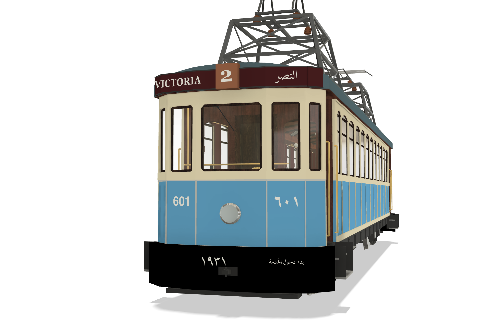
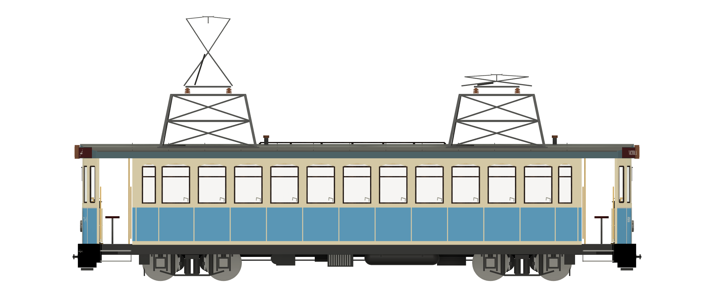
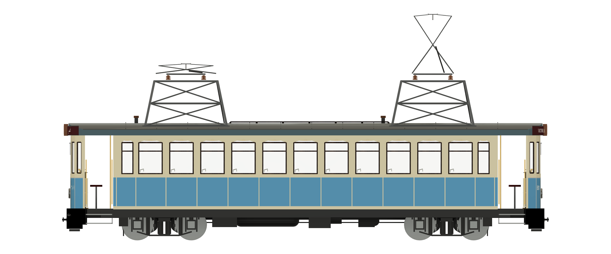
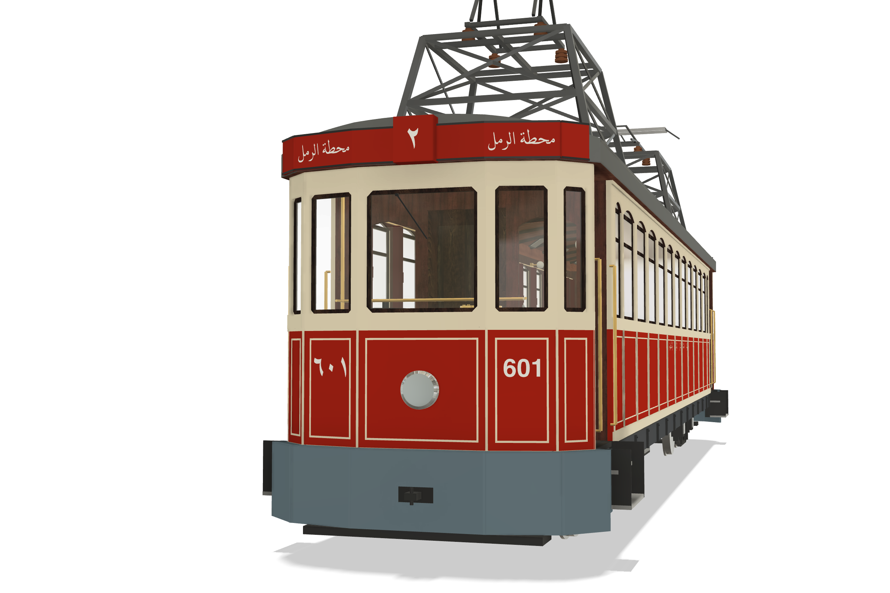
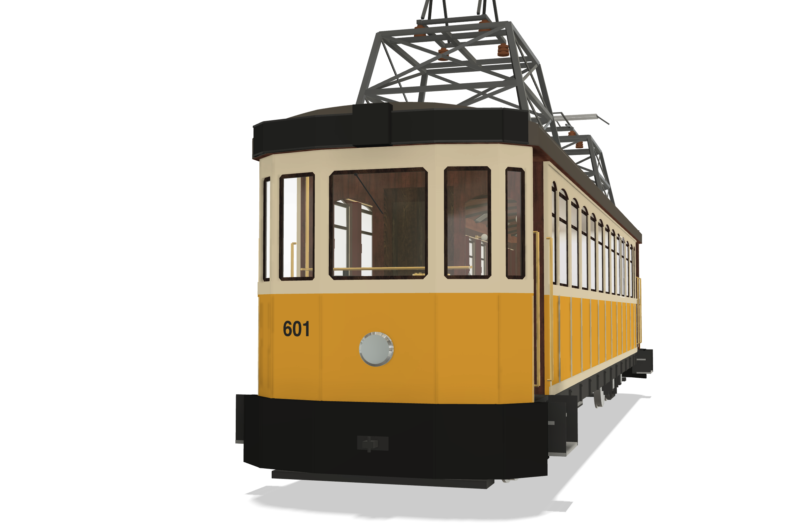
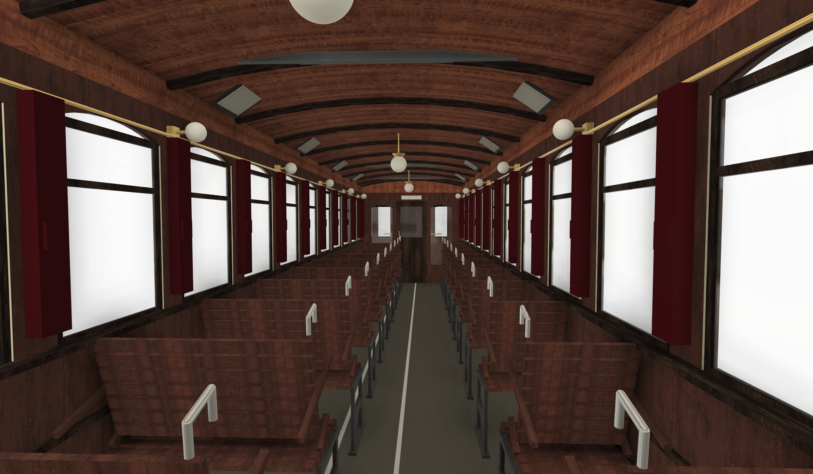
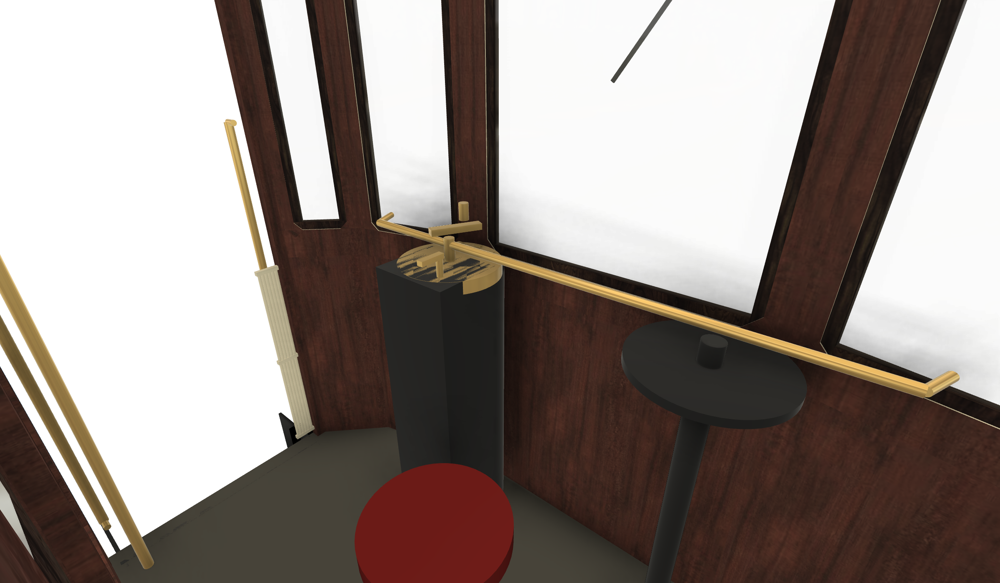
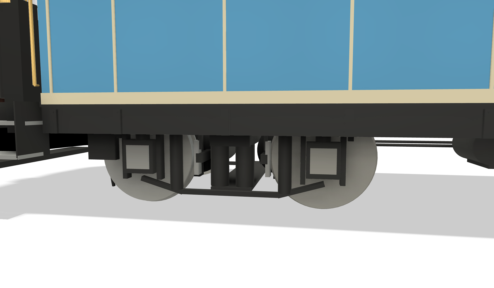
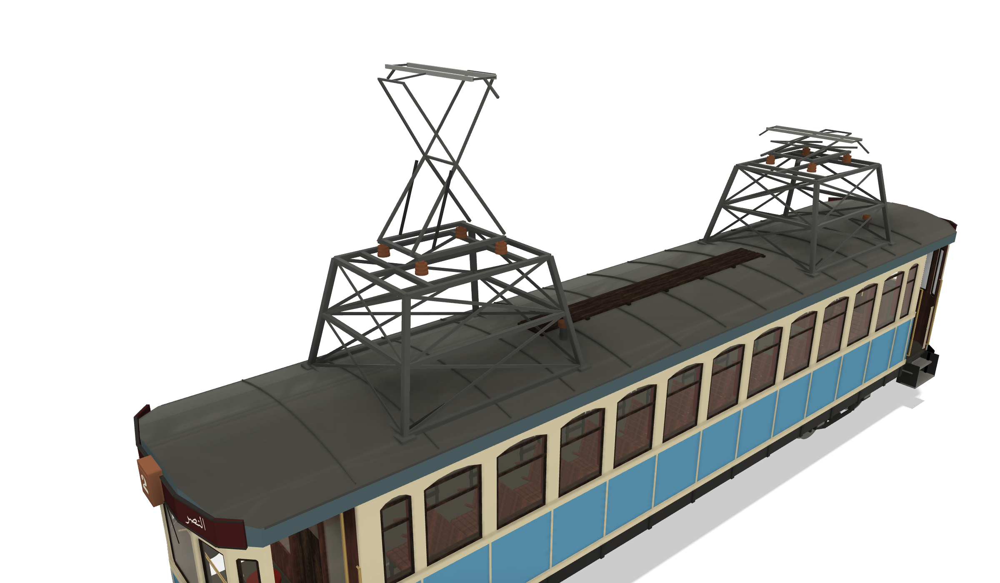

# Alexandria tram: Raml heritage car 601

A 1:1 parametric Fusion model of **car 601**, the four-axle wooden heritage motor car of the Alexandria (Egypt)
**Raml** tramway. The model is built entirely by Python scripts from a parameter table. No dimension of this car is
published anywhere, so the whole car was measured from photographs (photogrammetry).

## The vehicle

- **Type:** four-axle (two-bogie) wooden motor car, single-deck, **double-ended**, with open entrance platforms at
  all four corners and two roof lattice towers carrying diamond pantographs.
- **Builder and date are disputed:** Maschinenfabrik Oerlikon 1925, rebuilt from the 501–517 series (Urban Transport
  Magazine, en.wikipedia), or "Belgian, 1931" (Egyptian press; the car's own apron reads "بدء دخول الخدمة ١٩٣١",
  "entered service 1931"). A plausible reading is Oerlikon electrical equipment with a body built elsewhere.
- **History:** the only survivor of the old Raml bogie cars. A depot shunter and occasional special after regular
  old-car service ended (yellow works livery in 2002), light blue and cream in 2007–2019, then restored in red and
  cream for a heritage service launched on **6 October 2020** (Raml line 2). Out of service since the Raml line closed
  for reconstruction on 1 April 2026; museum-designated.

## What is modelled

- Body: side walls with 11 segmental-arch windows plus a narrow window at each end (separate lower and upper colour
  bodies, so the livery needs no face splitting), bulkheads, floor, arched roof cut to the bowed plan.
- Ends (both, from the same code): 5-facet bowed cab ends with dash, posts, glass, sashes, beading and lining,
  apron, coupler, headlight, destination board and route box, steps, folding gates, grab handles.
- Side details: waist and bottom rails, panel beading and lining, window sashes, solebars, underframe equipment
  (air reservoir, resistor grid, compressor).
- Running gear: equalizer-bar bogies with outside axleboxes and two nose-suspended motors.
- Roof: two lattice towers, diamond pantographs (each with its own raise height), cables, arrester, battens, walkway.
- Interior: cherry-varnished ceiling with walnut carlines, curtains, lamps, framed photographs, bulkhead doors,
  controllers and brake columns, 22 walkover wooden benches (2+1).
- Livery and lettering per livery: CoreText-shaped Arabic and Western lettering as 0.3 mm decals (fleet numbers
  601 / ٦٠١, destination boards, route numerals, apron legend, red-era side legend).

| | |
|---|---|
|  |  |
|  |  |
|  |  |
|  |  |

## Key dimensions

Confidence: **S** stated by a source · **S?** generic or analog · **V** measured from dated photos · **E** estimate.
Full sheet and method: [`references/notes/car601-dimensions.md`](references/notes/car601-dimensions.md).

**Scale:** the main source is the near-orthogonal transphoto 1920902 broadside (M. Lazarov, 2024). Its scale,
**11.25 mm/px ± 7 %**, comes from three soft anchors that agree within about 5 %: the pantograph-tower deck at about
4.5 m (the Raml wire height), the wheel rims (about 0.83 m) and the head-on width/dash ratio. Every length below
carries that ±7 %.

| Item | Value | Conf. |
|---|---|---|
| Length over dashes | 13.24 m | V |
| Body width | 2.40 m | V (LOW-MED) |
| Roof crown | 3.29 m | V |
| Floor / platform | 0.87 m | V |
| Platforms (dash → saloon end post) | 1.26 m each | V |
| Side windows | 11 × 0.69 m at 0.874 m pitch, + 0.34 m at each end | V |
| Bogie centres | 2.64 m from each end (7.96 m apart) | V |
| Bogie wheelbase / wheel | 1.52 m / 0.83 m | V / S? |
| Tower decks | 4.47 m, centred at 3.03 / 9.99 m | V |
| Seats | 33 (2+1 walkover) | V (layout) / E (count) |

## Liveries and variants

| `livery` | Scheme |
|---|---|
| **1** (default) | Light blue / cream, black apron with "بدء دخول الخدمة ١٩٣١", dark-red board "VICTORIA 2 النصر", c. 2007–2019 |
| 2 | Red / cream after the 2020 restoration, blue-grey apron, red board "محطة الرمل" with route ٢, side legend |
| 3 | Yellow works car, 2002 |

`panto_a_up` / `panto_b_up` set each pantograph's height above folded (default as in the 2024 broadside: A raised
1.4 m, B folded). `car_no` sets the fleet number. All three liveries are rendered in `docs/renders/`.

## Files

**Fusion** (project Eshera-Personal, folder *Alexandria Tram Model 4 - Raml Heritage 601*):

| Design | Contents |
|---|---|
| Alexandria Heritage Tram 601 | The complete car (single design, no assembly), saved in livery 1 |

**Exports** in [`models/`](models/):

| File | Format |
|---|---|
| `Alexandria Heritage Tram 601.f3d` | Fusion archive with the full timeline, user parameters and appearances |
| `Alexandria Heritage Tram 601.step` | STEP, solid geometry |

The `.f3d` excludes the photo underlay (canvas), because it is a third-party image. It can be recreated from the
sources in `references/` (see "Photo underlay" in [`fusion/README.md`](fusion/README.md)).

## Opening the exports

- **Fusion:** File → Open → Open from my computer → the `.f3d`. To change a dimension or livery, edit the
  parameter and re-run the relevant scripts.
- **Any other CAD:** open the `.step`. Units are millimetres, Y up, X from the end-A dash, Z lateral.

## Rebuilding from the scripts

The scripts in [`fusion/scripts/`](fusion/scripts/) rebuild the design from an empty document. They run inside
Fusion through a small exec loader; see [`fusion/README.md`](fusion/README.md) for the loader, the build order and
what each script makes. Lettering SVGs are generated on macOS with
[`tools/lettering/make_svgs_601.sh`](tools/lettering/make_svgs_601.sh) and the CoreText tool
[`text2svg.swift`](tools/lettering/text2svg.swift); the generated SVGs are committed.

## Printing notes

- The model is a **1:1 master**. Scale on export: H0 1:87, TT 1:120, N 1:160, O 1:43.5/1:45, etc.
  At 1:87 the car is about 152 mm long.
- The lettering decals are 0.3 mm thick at 1:1: hide the *Lettering* component and use waterslide decals made from
  the SVGs in `tools/lettering/svg/`, or thicken them for multi-colour printing.
- The lattice towers, pantographs, grab handles, gates and window sashes are too fine for most printers at small
  scales; thicken them or build them from brass/wire.
- For a printed shell, hide *Interior* and the glazing bodies.

## Known gaps

- **Absolute scale ±7 %**: no published dimension exists. One sourced length or height would fix it (APTA tram
  museum, or Richter, *Tramways Monthly* 2011).
- The 2002 centre side door (yellow era) is not modelled.
- In 2012 tower B carried a bow collector; the model has a diamond pantograph on both towers.
- The front-window layout differs slightly between the two ends in photos; the model uses one symmetric layout.
- Seat count and whether the platforms keep a driver's stool are estimates.

## Credits and sources

Research sources (Urban Transport Magazine, Wikipedia en/de, TransPhoto, Tram Travels, Sky News Arabia,
Al-Monitor) are cited in [`references/notes/research-raw.md`](references/notes/research-raw.md). Reference
photographs (TransPhoto, Urban Transport Magazine / Dirk Budach, Tram Travels / Henrik Boye, Wikimedia Commons) are
**not** included; [`references/SOURCES.md`](references/SOURCES.md) lists every one with author, licence and URL.
Build decisions and Fusion API gotchas: [`docs/BUILD-LOG.md`](docs/BUILD-LOG.md).

## Licence

- Code (`fusion/`, `tools/`): MIT, see [`LICENSE`](LICENSE).
- Models, documentation and renders: CC BY 4.0, see [`LICENSE-models.md`](LICENSE-models.md).

© 2026 Ibrahim Eshera.

## Related models

| Repository | Vehicle |
|---|---|
| [alexandria-tram-raml-221-223](https://github.com/imeshera/alexandria-tram-raml-221-223) | Kinki Sharyo Raml three-car set 221–223 |
| [alexandria-tram-raml-dd-224](https://github.com/imeshera/alexandria-tram-raml-dd-224) | Raml double-deck car 224 and its set |
| [alexandria-tram-gt6-894](https://github.com/imeshera/alexandria-tram-gt6-894) | Ex-Copenhagen Düwag GT6 894 |
| [alexandria-tram-city-1211-1212](https://github.com/imeshera/alexandria-tram-city-1211-1212) | Ganz-MÁVAG city two-car set 1211+1212 |
| [alexandria-lada-taxi](https://github.com/imeshera/alexandria-lada-taxi) | Alexandria Lada taxi |
